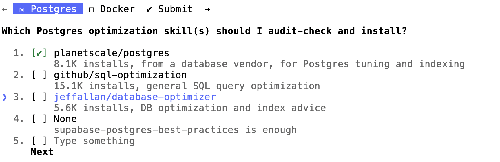

# find-relevant-skills

Finds [skills.sh](https://skills.sh) skills that match your repo's tech stack and installs the ones you approve.

## How to use

1. Install the skill:
   ```bash
   npx skills add shershen08/frs
   ```
2. Open your project in Claude Code and run:
   ```
   /find-relevant-skills
   ```
   or just ask: "find skills for this repo".
3. Review the shortlist it shows you.
4. Say which ones to install. They go into `.claude/skills/`. Nothing is installed without your OK.



## What it detects

It looks at manifest and config files up to 3 folders deep and skips `node_modules`, `vendor`, `dist`, `build`, `target`, virtualenvs and caches.

| Language | Found via |
|---|---|
| JavaScript, TypeScript | `package.json`, `tsconfig.json` |
| Python | `requirements.txt`, `pyproject.toml` |
| Java, Kotlin | `pom.xml`, `build.gradle(.kts)` |
| Go | `go.mod` |
| Rust | `Cargo.toml` |
| Ruby | `Gemfile` |
| PHP | `composer.json` |
| C# / .NET | `*.csproj` |

| Area | Detected |
|---|---|
| JS/TS frameworks | Next.js, React, React Native, Expo, Vue, Nuxt, Angular, Svelte, SvelteKit, Express, Fastify, Koa, NestJS, Electron |
| JS/TS tooling | Tailwind CSS, Vite, Webpack, Jest, Vitest, Playwright, Cypress, Redux, Zustand, styled-components, tRPC, GraphQL, Apollo |
| Data and services (JS) | Prisma, Drizzle, Mongoose, Supabase, Firebase, Stripe |
| Python | Django, Flask, FastAPI, SQLAlchemy, Pydantic, Celery, pytest, NumPy, pandas, PyTorch, TensorFlow, Hugging Face Transformers, LangChain, OpenAI SDK, boto3, Poetry |
| Java / Kotlin | Spring Boot, Spring Framework, Hibernate, JUnit, Maven, Gradle, Android |
| Go | Gin, Echo, Gorilla Mux, Fiber, gRPC, GORM |
| Rust | Actix Web, Axum, Tokio, Rocket |
| Ruby | Rails, Sinatra, RSpec |
| PHP | Laravel, Symfony |
| .NET | ASP.NET Core |
| Infra and CI | Docker, Docker Compose, Terraform (AWS, GCP, Azure, Kubernetes providers), Kubernetes manifests, GitHub Actions |
| Services in Compose | Postgres, MySQL, Redis, MongoDB, RabbitMQ, Kafka, Elasticsearch |

Anything not listed is not detected. It won't find Swift, Elixir, Dart/Flutter, Scala, C/C++, or other stacks.

## Requirements

- Node.js, for `npx skills`
- Python 3, for the stack detector
- Network access to skills.sh

## Shortcuts

Want the short `/frs` command? Copy the alias into your project:

```bash
mkdir -p .claude/commands && cp /path/to/frs/.claude/commands/frs.md .claude/commands/
```

## Alternatives

- `npx skills find <query>` searches skills.sh from the CLI. You pick the query yourself, and nothing scans your repo.
- Browse [skills.sh](https://skills.sh) by hand and install with `npx skills add <owner/repo>`.
- The `find-skills` skill from [vercel-labs/skills](https://github.com/vercel-labs/skills) helps your agent discover skills for a task you describe. It doesn't read your repo's manifests.
